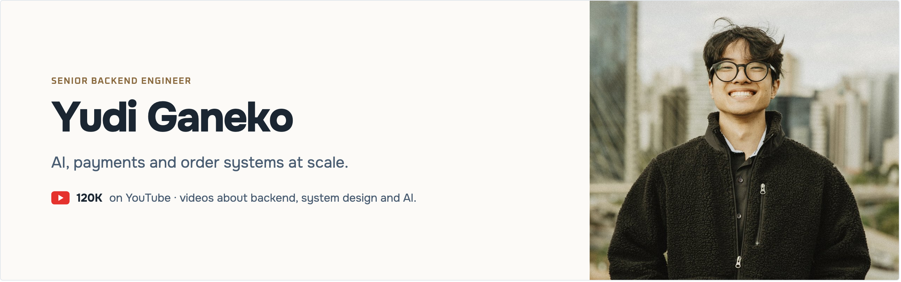

  <em>Senior Backend Engineer · 🌎 Worldwide · Tech Content Creator</em>

  <code>Kotlin</code> • <code>Java</code> • <code>Spring</code> • <code>Kafka</code> • <code>PostgreSQL</code> 
  <code>Cloudflare</code> • <code>AWS</code> • <code>GCP</code> • <code>Distributed Systems</code>

  
  
  
  

---

### 🧠 About me

- 💳 7+ years on payment and order systems at:
  - **Revolut**: Europe's most valuable fintech.
  - **iFood**: Latin America's largest food delivery, 100M+ orders a month.
  - **C6 Bank**: Brazilian digital bank with 40M+ clients.
  - **Grupo Boticário**: the world's largest beauty retail chain, ~4,000 stores.
- 🎥 I make videos about backend, system design and AI on [YouTube](https://www.youtube.com/@yudiganeko) and [Instagram](https://www.instagram.com/ganekoyudi).
- 🌎 Open to remote backend roles with international teams.

### 🛠️ Projects

- [**second-brain-mcp**](https://github.com/YudiG12/second-brain-mcp): my Markdown notes in every AI client, with keyword and semantic search. Cloudflare Workers, Durable Objects, Queues, Vectorize.
- [**video-planner**](https://github.com/YudiG12/video-planner): plan YouTube videos and reels; AI agents edit scripts over MCP. Cloudflare Workers + D1.

  <em>Studying, building and sharing it along the way.</em> ☕

